<picture>
  <source media="(prefers-color-scheme: dark)" srcset="hero-dark.svg">
  
</picture>

  
  
  

 

<picture>
  <source media="(prefers-color-scheme: dark)" srcset="stats-dark.svg">
  
</picture>

## About me

I started as a full stack web developer, moved into penetration testing, and spent the last four years in incident response at a major Canadian bank. I see every system from three sides: how it's built, how it gets attacked, and how to protect it.

Based in Kitchener, ON, Canada.

## Experience

<picture>
  <source media="(prefers-color-scheme: dark)" srcset="path-dark.svg">
  
</picture>

## Toolkit

| Area | Tools |
|---|---|
| **SIEM & detection** | Microsoft Sentinel · Splunk · IBM QRadar · LogRhythm · KQL · SPL |
| **EDR** | CrowdStrike Falcon · Microsoft Defender for Endpoint · SentinelOne |
| **Offensive security** | VAPT · Web app pentesting · OWASP Top 10 · Network testing · API security |
| **Cloud & identity** | Azure · Entra ID · AWS CloudTrail · GuardDuty · GCP & GKE |
| **Email security** | SPF · DKIM · DMARC · Any.run · URLScan · VirusTotal |
| **Vulnerability mgmt** | Qualys VMDR · CVSS · EPSS · CISA KEV |
| **Automation** | Python · PowerShell · REST APIs · SOAR playbooks · GitHub Actions |
| **Frameworks** | MITRE ATT&CK · NIST CSF · NIST SP 800-61 · ISO 27001 · PCI-DSS · SOC 2 · OSFI |

## Certifications

| | | |
|:---:|:---:|:---:|
| **CCSP** | **SC-200** | **AZ-500** |
| Certified Cloud Security Professional | Security Operations Analyst Associate | Azure Security Engineer Associate |
| ISC2 | Microsoft | Microsoft |

## Need a website?

I design, build and host websites for shops, salons, restaurants and small businesses across Canada and the US, with security set up from day one: HTTPS, hardening, backups and monitoring.

**Reach me:** dktechcyber@gmail.com · [LinkedIn](https://www.linkedin.com/in/dk-rajput)
